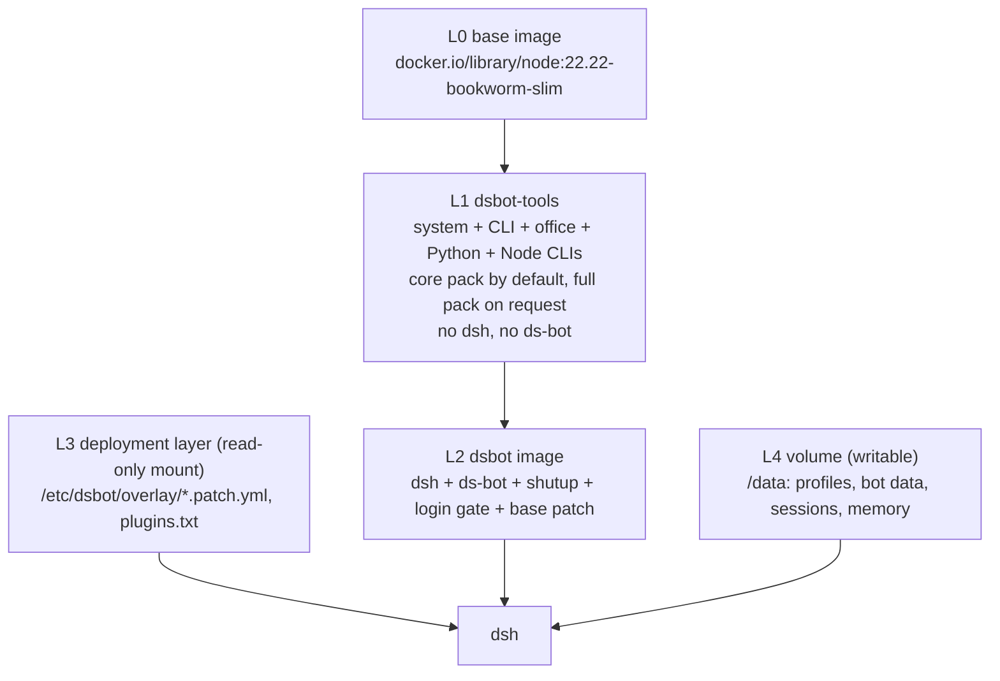

# Architecture

## Layers



L1 is not a hidden implementation detail of L2: because both start from the same
base image, L2 can be built `FROM dsbot-tools:<tag>` or `FROM docker.io/library/node:22.22-bookworm-slim`
(a tool-less image). The tool image therefore behaves like a prebuilt variant of the
base, and it is usable on its own as a development container.

## Patch precedence

dsh composes its plugin tree from several layers, and **later layers win**:

1. bundle layer — dsh's own bundles plus every bundle the deployment layer installs
2. volume profile — `$DSH_HOME/profiles/web/cordis.patch.yml`, which is the file the
   DSH settings UI writes to
3. deployment layer — `/etc/dsbot/overlay.yml` and `/etc/dsbot/overlay/*.patch.yml`,
   sorted by file name
4. the image — `dsh-layers/base-layer.patch.yml` and the bundled plugins' own bundle
   patches (shutup and the login gate)

The rule that follows: **the deployment layer may tune the volume, but never the image.**
Every patch the image carries is applied last, so it is the last word on the rows it
inserts, on the plugins it carries and on their settings. Providers, default models, the
web search provider and plugin choices belong to layer 3.

## Three ways a plugin reaches a container

| source | where it lives | mechanism | removable at runtime |
|---|---|---|---|
| bundled with the image | `/opt/dsh-plugins`, registered as a dsh carried package | built with `npm pack`/tarball, activated by a `--patch` of its own bundle patch | no (read-only root) |
| declared by the deployment layer | `/etc/dsbot/overlay/plugins.txt` | `dsbot-plugins sync` runs `dsh plugin --profile web add` into the volume profile; its bundle patch then applies as layer 1 | yes, but it is reinstalled on the next start |
| installed by a Bot | `/data/profiles/web` | the DSH UI or `dsh plugin add` | yes, permanently |

The split exists so that a Bot can install and remove plugins freely without being able
to disturb the image or the deployment layer, and so that a plugin that must be present
(because it is the only door) cannot be removed at all.

## Why bundled packages are not simply copied in

dsh resolves plugin names against its **own declared dependencies** (carried packages),
not through Node's `node_modules` lookup chain. A directory dropped into
`<dsh>/node_modules/` is ignored unless it is also registered in dsh's `package.json`.
The image therefore unpacks each bundled plugin from its tarball and registers it by
hand. npm's tree resolver cannot be used for these packages: their peer dependencies are
all provided by dsh at runtime, and a second copy of `@deepseek-ai/cordis` would be a
second service registry.

## The volume

```text
/data/                    DSH_HOME
├── profiles/web/         dsh profile: package.json, node_modules, cordis.patch.yml
├── bot/                  DS Bot data: roster, state, memory, usage, logs
├── sessions/  storages/  cache/  attachments/
├── auth/token            login gate token (token mode)
├── .overlay-plugins/     staged copies of local plugins from the deployment layer
└── .pnpstore .npmcache .pnpm-home .npm-global .cache
```

The cache directories exist because the root filesystem is read-only: every path pnpm,
npm and dsh may write to is redirected into the volume by `ENV` in the image.
